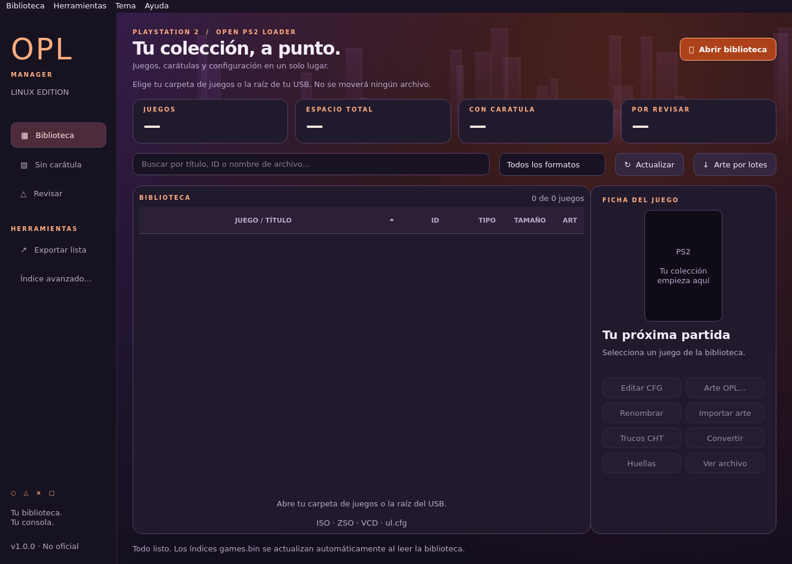

# OPL Manager Linux · v1.0.0

**English** | [Español](README_ES.md)

A native Linux desktop client for **Open PS2 Loader** libraries, built from the ground up with Python and Qt to meet the need for a dedicated Linux alternative. Inspired by **OPL Manager for Windows by danielb**, this is an independent, unofficial project with its own Linux interface and application engine. It does not require Wine or Windows programs.



## Download and install

Get the packages and `SHA256SUMS` from [Releases](https://github.com/N3ruk/OPL-Manager-Linux/releases/latest).

| Package | Requirements |
| --- | --- |
| `OPL-Manager-Linux-1.0.0-x86_64.AppImage` | x86_64 GNU/Linux, glibc 2.35+, graphical desktop; Python, Qt, Pillow and LZ4 included |
| `opl-manager-linux_1.0.0_amd64.deb` | x86_64 Debian/Ubuntu-compatible system, glibc 2.35+; all application dependencies bundled |
| `opl-manager-linux-1.0.0-source.tar.gz` | Source code, resources, documentation, tests and packaging scripts |

The AppImage targets modern glibc distributions, such as Ubuntu 22.04+, Debian 12+ and Linux Mint 21+. It is not an ARM, 32-bit or Alpine/musl package. Both packages are x86_64/amd64 and bundle Python/Qt; they do not require distribution PyQt packages. Package support is not a promise of compatibility with every Linux distribution.

### AppImage

```sh
chmod +x OPL-Manager-Linux-1.0.0-x86_64.AppImage
./OPL-Manager-Linux-1.0.0-x86_64.AppImage
# Without FUSE:
./OPL-Manager-Linux-1.0.0-x86_64.AppImage --appimage-extract-and-run
```

### Debian / Ubuntu

```sh
sudo apt install ./opl-manager-linux_1.0.0_amd64.deb
```

The DEB includes the same Python/Qt runtime as the AppImage. APT checks the declared system glibc requirement; no pip downloads or separate Python/Qt installation are needed. Open **OPL Manager Linux** from the application menu. No Windows components, game images or artwork collection are distributed.

## Quick start

1. Select your OPL library root, `DVD`, `CD` or `POPS` directory, or a directory of standalone images.
2. Review detected game IDs, local titles, regions and warnings. The scanner does not move games or edit image contents.
3. If OPL folders are missing, choose whether to create them. Declining still lets you browse existing folders.
4. Select a game to manage artwork, CFG settings, cheats or virtual memory cards.
5. Use **Tema** between **Herramientas** and **Ayuda** to switch themes. The interface is currently in Spanish; documentation is available in both languages.

Selecting a library, restoring it at startup or refreshing it automatically maintains **CD/DVD `games.bin` indexes at 92 bytes per game**. This writes index files, not game images. See [usage and index details](docs/USAGE.md).

## Features

- ISO/ZSO/VCD libraries and USBExtreme `ul.cfg` catalogs; reads `SYSTEM.CNF` IDs from ISO/ZSO and warns about filename/content mismatches.
- Offline database of **12,841 serials**, titles and regions derived from PCSX2 GameIndex.
- Search and format, missing-cover and warning filters; CSV export with spreadsheet-formula protection.
- Classic `SLES_123.45.Title.iso` and modern `Title.iso` naming, with collision checks and batch modern renaming.
- Eight artwork types: **COV, COV2, ICO, LAB, LGO, BG, SCR, SCR2**. Local import, resizing, remote alternatives, previews and optional batch downloads through OPL Manager API V6.
- Tabbed CFG editor: metadata, compatibility modes, GSM, cheats, VMC assignments, global/per-game settings and advanced text. Unknown keys and custom values are preserved; saving creates `.bak` backups and checks external edits.
- Formatted VMC creation at **8, 16, 32 and 64 MiB**, plus assignment to either slot.
- Batch completion of missing CFG titles without replacing existing titles.
- Background **ISO ↔ ZSO** conversion with cancellation; the original is retained and existing destinations are never overwritten.
- **CRC32, MD5, SHA-1 and SHA-256** in one pass, including unambiguous complete UL parts; hashes are not automatic Redump verification.
- Automatic 92-byte CD/DVD indexes; optional 188-byte records under **Índice avanzado…**.
- Five persistent themes: **Azul, Verde, Rojo, UGM** (default, purple/orange) and **Clásico estilo Windows**.

## Scope and privacy

Library scanning covers the selected directory and direct `DVD`/`CD`/`POPS` subdirectories, not the entire drive. ART/CFG/CHT files live in the associated OPL root. Preferences are stored in `~/.config/opl-manager-linux/settings.json`.

Artwork lookup is optional and requires Internet access. The service receives an anonymous service-session identifier, requested game ID and protocol fields, not your library paths or game files. Downloaded images remain subject to their owners' rights.

Not implemented: APA/HDL internal-HDD installation, UL creation/renaming, optical-disc extraction, BIN-to-ISO conversion, artwork upload, PS2 synchronization or a built-in application updater. VCD support is cataloging only; UL support is cataloging, associated metadata/artwork and complete-part hashing. This application does not start or configure a UDPBD/SMB server.

Physical PS2 validation is still pending. Compatibility of ZSO, artwork, CFG, VMC and index profiles depends on the loader and version you use. No full feature parity with the Windows application is claimed.

## Documentation

- [Usage, indexes and troubleshooting](docs/USAGE.md) · [Español](docs/es/USAGE.md)
- [Build and test packages](docs/BUILD.md) · [Español](docs/es/BUILD.md)
- [Release notes](CHANGELOG.md) · [Español](CHANGELOG_ES.md)
- [Verification](docs/VERIFICATION.md) · [Español](docs/es/VERIFICATION.md)
- [Third-party credits and licenses](THIRD_PARTY.md)

## Development

Install `python3`, `python3-pyqt6`, `python3-pil` and `liblz4-1`, then:

```sh
./opl-manager-linux
QT_QPA_PLATFORM=offscreen python3 -m unittest discover -s tests -v
./opl-manager-linux --version
QT_QPA_PLATFORM=offscreen ./opl-manager-linux --self-test
```

## License and credits

Application code: **GPL-3.0-or-later**, see [LICENSE](LICENSE). This does not relicense third-party components or data. PCSX2 database attribution, OPL interoperability references and bundled runtime licenses are documented in [THIRD_PARTY.md](THIRD_PARTY.md) and `licenses/`.

Thanks to danielb for OPL Manager, the Open PS2 Loader contributors and PCSX2 contributors. PlayStation is a trademark of Sony; this project is not affiliated with Sony, PCSX2 or OPL Manager.
