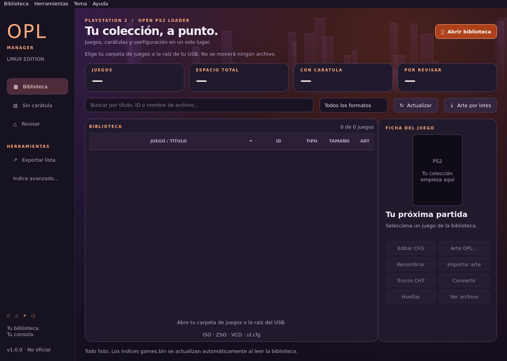

# OPL Manager Linux · v1.0.0

[English](README.md) | **Español**

Cliente de escritorio **nativo de Linux** para bibliotecas de **Open PS2 Loader**, creado desde cero con Python y Qt ante la necesidad de disponer de una alternativa propia en Linux. Inspirado en **OPL Manager para Windows de danielb**, es un proyecto independiente y no oficial, con interfaz y motor propios. No necesita Wine ni programas Windows.



## Descargar e instalar

Descarga los paquetes y `SHA256SUMS` desde [Releases](https://github.com/N3ruk/OPL-Manager-Linux/releases/latest).

| Paquete | Requisitos |
| --- | --- |
| `OPL-Manager-Linux-1.0.0-x86_64.AppImage` | GNU/Linux x86_64, glibc 2.35+ y escritorio gráfico; incluye Python, Qt, Pillow y LZ4 |
| `opl-manager-linux_1.0.0_amd64.deb` | Debian/Ubuntu x86_64 compatible, glibc 2.35+; todas las dependencias de la aplicación incluidas |
| `opl-manager-linux-1.0.0-source.tar.gz` | Código, recursos, documentación, pruebas y scripts de empaquetado |

La AppImage se dirige a distribuciones glibc modernas como Ubuntu 22.04+, Debian 12+ y Linux Mint 21+. No es para ARM, 32 bits ni Alpine/musl. Ambos paquetes son x86_64/amd64 e incluyen Python/Qt; no necesitan los paquetes PyQt de la distribución. No se promete compatibilidad con absolutamente cualquier distribución.

```sh
chmod +x OPL-Manager-Linux-1.0.0-x86_64.AppImage
./OPL-Manager-Linux-1.0.0-x86_64.AppImage
# Sin FUSE:
./OPL-Manager-Linux-1.0.0-x86_64.AppImage --appimage-extract-and-run
# Debian/Ubuntu:
sudo apt install ./opl-manager-linux_1.0.0_amd64.deb
```

El DEB incluye el mismo runtime Python/Qt que la AppImage. APT comprueba el requisito glibc del sistema; no se usa pip ni se necesita instalar Python/Qt por separado. Abre **OPL Manager Linux** desde el menú. No se distribuyen componentes Windows, juegos ni colecciones de carátulas.

## Primeros pasos

1. Selecciona la raíz de tu biblioteca OPL, `DVD`, `CD`, `POPS` o una carpeta de imágenes sueltas.
2. Revisa ID, títulos locales, región y avisos. El escáner no mueve juegos ni modifica su contenido.
3. Si faltan carpetas OPL, decide si crearlas; puedes seguir leyendo sin crearlas.
4. Selecciona un juego para gestionar arte, CFG, trucos y VMC.
5. Cambia el aspecto desde **Tema**, entre **Herramientas** y **Ayuda**. La interfaz está en español y la documentación en ambos idiomas.

Abrir, restaurar al arrancar y actualizar una biblioteca mantiene automáticamente **`games.bin` de CD/DVD a 92 bytes por juego**. Se escriben los índices, no las imágenes de juegos. Consulta la [guía de uso](docs/es/USAGE.md).

## Funciones

- Bibliotecas ISO/ZSO/VCD y catálogo USBExtreme `ul.cfg`; lectura del ID de `SYSTEM.CNF` en ISO/ZSO y aviso de discrepancias con el nombre.
- Base local de **12.841 seriales**, títulos y regiones derivada de PCSX2 GameIndex.
- Búsqueda, filtros por formato, carátulas ausentes y avisos; exportación CSV protegida frente a fórmulas.
- Nombres clásicos `SLES_123.45.Título.iso` y modernos `Título.iso`, control de colisiones y renombrado moderno por lotes.
- Ocho tipos de arte: **COV, COV2, ICO, LAB, LGO, BG, SCR y SCR2**. Importación local, ajuste de tamaño, alternativas, vista previa y descarga opcional por lotes mediante OPL Manager API V6.
- Editor CFG con pestañas: metadatos, compatibilidad, GSM, trucos, VMC, valores globales/por juego y texto avanzado. Conserva claves y valores desconocidos; genera `.bak` y detecta modificaciones externas.
- Creación de VMC formateadas de **8, 16, 32 y 64 MiB**, asignables a ambas ranuras.
- Completar títulos CFG ausentes por lotes sin sustituir los existentes.
- Conversión **ISO ↔ ZSO** en segundo plano, cancelable, conservando el original y sin sobrescribir destinos.
- **CRC32, MD5, SHA-1 y SHA-256** en una lectura, incluidas partes UL completas e inequívocas; no es cotejo automático con Redump.
- Índices automáticos de 92 bytes y perfil opcional de 188 bytes en **Índice avanzado…**.
- Cinco temas persistentes: **Azul, Verde, Rojo, UGM** (predeterminado, violeta/naranja) y **Clásico estilo Windows**.

## Alcance y privacidad

Se escanea la carpeta elegida y sus subcarpetas directas DVD/CD/POPS, no todo el disco. ART/CFG/CHT se guardan en la raíz OPL. Preferencias: `~/.config/opl-manager-linux/settings.json`.

El arte remoto es opcional y necesita Internet. El servicio recibe un identificador anónimo de sesión, el ID solicitado y campos de protocolo, no rutas ni archivos de juegos. Las imágenes conservan los derechos de sus titulares.

No incorpora instalación HDD APA/HDL, creación/renombrado UL, extracción óptica, BIN a ISO, subida de arte, sincronización PS2 ni actualizador propio. VCD solo se cataloga; UL admite catálogo, metadatos/arte asociados y huellas de partes completas. No inicia ni configura un servidor UDPBD/SMB.

La validación física en PS2 está pendiente. ZSO, arte, CFG, VMC e índices dependen del cargador y su versión. No se afirma paridad total con la aplicación Windows.

## Documentación y desarrollo

- [Uso, índices y resolución de problemas](docs/es/USAGE.md).
- [Construcción y pruebas](docs/es/BUILD.md).
- [Cambios](CHANGELOG_ES.md) y [verificación](docs/es/VERIFICATION.md).
- [Créditos y licencias](THIRD_PARTY.md).

Con `python3`, `python3-pyqt6`, `python3-pil` y `liblz4-1` instalados:

```sh
./opl-manager-linux
QT_QPA_PLATFORM=offscreen python3 -m unittest discover -s tests -v
./opl-manager-linux --version
QT_QPA_PLATFORM=offscreen ./opl-manager-linux --self-test
```

Código de la aplicación bajo **GPL-3.0-or-later**: [LICENSE](LICENSE). Los componentes y datos externos conservan sus licencias. Gracias a danielb, a Open PS2 Loader y a los colaboradores de PCSX2. PlayStation es una marca de Sony; no hay afiliación con Sony, PCSX2 ni OPL Manager.
